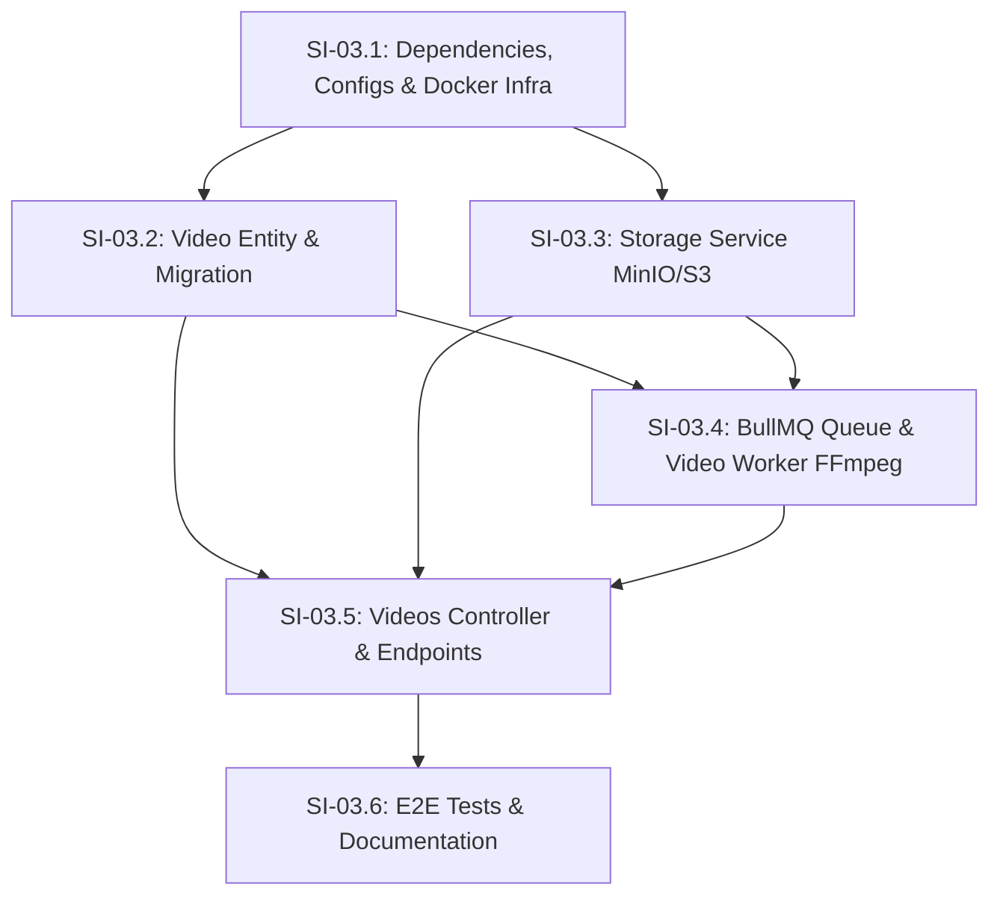

# Phase 03 — Upload e Processamento de Vídeos

## Objective

Implementar a arquitetura completa de upload e processamento assíncrono de vídeos no StreamTube: suporte a arquivos de grande porte (até 10GB) via multipart upload pré-assinado com MinIO/S3 (sem sobrecarga na API), pré-cadastro automático em rascunho vinculado ao canal do usuário, processamento assíncrono em fila BullMQ com Redis, worker desacoplado com FFmpeg/FFprobe para extração de metadados e geração automática de thumbnail, URLs únicas amigáveis (NanoID), reprodução via streaming com Range Requests (HTTP 206 Partial Content) e download de vídeos.

---

## Step Implementations

### SI-03.1 — Dependencies, Configuration Namespaces, and Docker Compose Infrastructure

**Description:** Instalar as dependências de produção para Object Storage (AWS SDK S3), filas (BullMQ + Redis), FFmpeg e identificadores únicos (NanoID); criar os namespaces de configuração `storage` e `queue` no padrão `registerAs()`; atualizar o schema Joi de validação de ambiente; e configurar os novos serviços de infraestrutura (`storage`/MinIO e `redis`) no `compose.yaml`.

**Technical actions:**

- Instalar dependências de produção em `nestjs-project`:
  - `@aws-sdk/client-s3@^3.758.0`, `@aws-sdk/s3-request-presigner@^3.758.0`
  - `@nestjs/bullmq@^11.0.2`, `bullmq@^5.41.0`, `ioredis@^5.6.0`
  - `fluent-ffmpeg@^2.1.3`, `@types/fluent-ffmpeg@^2.1.27`
  - `nanoid@^3.3.8`
- Criar `src/config/storage.config.ts` com `registerAs('storage', ...)` lendo:
  - `STORAGE_ENDPOINT` (string, default `'http://storage:9000'`)
  - `STORAGE_REGION` (string, default `'us-east-1'`)
  - `STORAGE_ACCESS_KEY` (string, default `'minioadmin'`)
  - `STORAGE_SECRET_KEY` (string, default `'minioadmin'`)
  - `STORAGE_BUCKET_MEDIA` (string, default `'streamtube-media'`)
- Criar `src/config/queue.config.ts` com `registerAs('queue', ...)` lendo:
  - `REDIS_HOST` (string, default `'redis'`)
  - `REDIS_PORT` (number, default `6379`)
- Atualizar `src/config/env.validation.ts` com todas as novas variáveis validadas via Joi e atualizar `.env.example`.
- Atualizar `compose.yaml`:
  - Adicionar serviço `storage` (imagem `minio/minio`, comando `server /data --console-address ":9001"`, portas `9000:9000` e `9001:9001`, variáveis de ambiente `MINIO_ROOT_USER=minioadmin`, `MINIO_ROOT_PASSWORD=minioadmin`).
  - Adicionar serviço `redis` (imagem `redis:7-alpine`, porta `6379:6379`).
  - Adicionar serviço `worker` dedicado para processamento assíncrono em segundo plano (imagem baseada em `Dockerfile.dev` com `ffmpeg` e `ffprobe`, volumes sincronizados, dependendo de `db`, `storage` e `redis`).
  - Criar `src/worker.ts` e scripts no `package.json` (`start:worker`, `start:worker:dev`, `start:worker:prod`) para execução do container worker isolado da API.
  - Atualizar `depends_on` do serviço `nestjs-api` para incluir `storage` e `redis`.

**Tests:**

| File | Layer | Verifies |
|------|-------|----------|
| `src/config/storage.config.spec.ts` | Unit | Valores padrão e mapeamento correto de variáveis de ambiente de storage |
| `src/config/queue.config.spec.ts` | Unit | Valores padrão e mapeamento correto de host e porta do Redis |

**Dependencies:** Nenhuma

**Acceptance criteria:**
- A aplicação compila sem erros com `npx tsc --noEmit`.
- Se as variáveis obrigatórias estiverem ausentes com tipo inválido, a validação Joi interrompe o bootstrap.
- Os serviços `storage` (MinIO) e `redis` sobem no Docker Compose e aceitam conexões nos hostnames de rede interna.

---

### SI-03.2 — Video Entity, Status Enum, and TypeORM Migration

**Description:** Criar a entidade `Video` no TypeORM com relacionamento N:1 com `Channel`, enum de status (`DRAFT`, `UPLOADING`, `PROCESSING`, `READY`, `FAILED`), colunas para chaves de storage (vídeo bruto, thumbnail), metadados técnicos (duração, resolução, codec, bitrate) e campo de erro de processamento. Gerar e validar a migration TypeORM correspondente.

**Technical actions:**

- Criar `src/videos/enums/video-status.enum.ts`:
  ```typescript
  export enum VideoStatus {
    DRAFT = 'DRAFT',
    UPLOADING = 'UPLOADING',
    PROCESSING = 'PROCESSING',
    READY = 'READY',
    FAILED = 'FAILED',
  }
  ```
- Criar `src/videos/entities/video.entity.ts`:
  - `id`: uuid PK (`@PrimaryGeneratedColumn('uuid')`)
  - `slug`: varchar(20), unique (`@Column({ type: 'varchar', length: 20, unique: true })`)
  - `title`: varchar(255) (`@Column({ type: 'varchar', length: 255 })`)
  - `description`: text nullable (`@Column({ type: 'text', nullable: true })`)
  - `channel_id`: uuid FK (`@Column({ type: 'uuid' })`)
  - `status`: enum `VideoStatus` (`@Column({ type: 'enum', enum: VideoStatus, default: VideoStatus.DRAFT })`)
  - `raw_storage_key`: varchar(500) nullable (`@Column({ type: 'varchar', length: 500, nullable: true })`)
  - `thumbnail_storage_key`: varchar(500) nullable (`@Column({ type: 'varchar', length: 500, nullable: true })`)
  - `duration`: integer nullable (`@Column({ type: 'integer', nullable: true })`)
  - `width`: integer nullable (`@Column({ type: 'integer', nullable: true })`)
  - `height`: integer nullable (`@Column({ type: 'integer', nullable: true })`)
  - `codec`: varchar(50) nullable (`@Column({ type: 'varchar', length: 50, nullable: true })`)
  - `bitrate`: integer nullable (`@Column({ type: 'integer', nullable: true })`)
  - `processing_error`: text nullable (`@Column({ type: 'text', nullable: true })`)
  - `created_at`: CreateDateColumn
  - `updated_at`: UpdateDateColumn
  - Relacionamento: `@ManyToOne(() => Channel, { onDelete: 'CASCADE' })` com `@JoinColumn({ name: 'channel_id' })`
- Criar migration `CreateVideosTable` em `src/database/migrations/` criando a tabela `videos` com foreign keys, índices no `slug` e `channel_id`, e enum de status.
- Criar `src/videos/videos.module.ts` importando `TypeOrmModule.forFeature([Video])`.

**Tests:**

| File | Layer | Verifies |
|------|-------|----------|
| `src/videos/entities/video.entity.integration-spec.ts` | Integration | Criação de vídeo com defaults, constraint única de slug, relacionamento com canal, persistência de metadados e enum de status |

**Dependencies:** SI-03.1

**Acceptance criteria:**
- A migration executa com sucesso via `npm run migration:run` criando a tabela `videos`.
- Slugs duplicados são rejeitados pelo banco de dados com erro de chave única.
- Vídeos criados têm status inicial `DRAFT` por padrão.

---

### SI-03.3 — Storage Service (MinIO / S3 Operations & Presigned Multipart Upload)

**Description:** Implementar o serviço `StorageService` responsável por toda a comunicação com a API S3/MinIO: criação automática de bucket, geração de URLs pré-assinadas para multipart upload (iniciação, presign de partes, conclusão e cancelamento), leitura de metadados de objeto (`headObject`), download via streams e suporte a streaming com cabeçalho `Range`.

**Technical actions:**

- Criar `src/videos/storage/storage.service.ts`:
  - `onModuleInit()`: Garante que o bucket `streamtube-media` existe via `HeadBucketCommand` / `CreateBucketCommand`.
  - `initiateMultipartUpload(key: string, contentType: string): Promise<string>`: Executa `CreateMultipartUploadCommand` e retorna o `UploadId`.
  - `getPresignedUploadPartUrl(key: string, uploadId: string, partNumber: number): Promise<string>`: Gera URL pré-assinada com `UploadPartCommand` expirando em 1 hora.
  - `completeMultipartUpload(key: string, uploadId: string, parts: { PartNumber: number; ETag: string }[]): Promise<void>`: Executa `CompleteMultipartUploadCommand`.
  - `abortMultipartUpload(key: string, uploadId: string): Promise<void>`: Executa `AbortMultipartUploadCommand`.
  - `getObjectHead(key: string): Promise<{ contentLength: number; contentType: string }>`: Executa `HeadObjectCommand`.
  - `getObjectStream(key: string, range?: string): Promise<{ stream: NodeJS.ReadableStream; contentLength: number; contentRange?: string; acceptRanges: string; contentType: string }>`: Executa `GetObjectCommand` repassando o parâmetro `Range` quando presente.
  - `uploadBuffer(key: string, buffer: Buffer, contentType: string): Promise<void>`: Executa `PutObjectCommand` (usado para salvar thumbnails).

**Tests:**

| File | Layer | Verifies |
|------|-------|----------|
| `src/videos/storage/storage.service.spec.ts` | Unit | Geração de comandos S3, assinatura de URLs de partes, tratamento de parâmetros de Range |
| `src/videos/storage/storage.service.integration-spec.ts` | Integration | Upload real de partes no MinIO, conclusão de multipart, recuperação de streams com Range e upload de thumbnails |

**Dependencies:** SI-03.1

**Acceptance criteria:**
- `StorageService` inicializa e cria o bucket `streamtube-media` caso ainda não exista.
- Gera URLs pré-assinadas válidas para cada parte do multipart upload.
- Conclui o multipart upload no MinIO tornando o objeto acessível para leitura.
- Retorna streams parciais quando o cabeçalho `Range` é fornecido.

---

### SI-03.4 — Queue Module, Video Processing Service, and Worker (FFmpeg / FFprobe)

**Description:** Configurar o módulo BullMQ no NestJS para a fila `video-processing`; criar o produtor de jobs que enfileira tarefas com política de 3 retentativas e backoff exponencial; implementar o processador (`VideoProcessor`) que consome os jobs, baixa o vídeo temporariamente, executa `ffprobe` para extrair metadados e `ffmpeg` para gerar thumbnail a 1s do vídeo, faz upload da thumbnail para o MinIO, e atualiza o status do vídeo para `READY` (ou `FAILED` com mensagem de erro).

**Technical actions:**

- Configurar `BullModule.forRootAsync` em `AppModule` usando `queueConfig`.
- Registrar a fila `video-processing` em `VideosModule` via `BullModule.registerQueue({ name: 'video-processing' })`.
- Criar `src/videos/queue/video-queue.service.ts`:
  - Método `enqueueVideoProcessing(videoId: string, rawStorageKey: string): Promise<void>` com `{ attempts: 3, backoff: { type: 'exponential', delay: 5000 } }`.
- Criar helper / service `src/videos/processors/ffmpeg.helper.ts`:
  - `probeVideo(filePath: string): Promise<{ duration: number; width: number; height: number; codec: string; bitrate?: number }>`
  - `extractThumbnail(videoFilePath: string, outputThumbnailPath: string, timestamp?: string): Promise<void>`
- Criar `src/videos/processors/video.processor.ts`:
  - `@Processor('video-processing')` estendendo `WorkerHost`.
  - Método `process(job: Job<{ videoId: string; rawStorageKey: string }>)`:
    1. Atualiza vídeo para status `PROCESSING`.
    2. Cria diretório temporário local (`/tmp/video-...` ou `os.tmpdir()`).
    3. Faz download do stream do vídeo bruto do MinIO para arquivo temporário.
    4. Executa `probeVideo` para obter metadados.
    5. Executa `extractThumbnail` gerando `thumb.jpg`.
    6. Lê `thumb.jpg` e faz upload para `thumbnails/{videoId}/thumb.jpg` no MinIO via `storageService.uploadBuffer`.
    7. Atualiza entidade `Video` no PostgreSQL: `status = READY`, `duration`, `width`, `height`, `codec`, `bitrate`, `thumbnail_storage_key = thumbnails/{videoId}/thumb.jpg`.
    8. Remove arquivos temporários no bloco `finally`.
  - Tratamento de erro (`@OnWorkerEvent('failed')` / catch do job): se todas as tentativas esgotarem, atualiza `Video.status = FAILED` e salva a mensagem de erro em `Video.processing_error`.

**Tests:**

| File | Layer | Verifies |
|------|-------|----------|
| `src/videos/processors/ffmpeg.helper.spec.ts` | Unit | Parsing de saída do ffprobe e chamada correta dos comandos ffmpeg |
| `src/videos/processors/video.processor.spec.ts` | Unit | Fluxo de processamento, atualização de estados e limpeza de arquivos temporários |
| `src/videos/queue/video-queue.service.spec.ts` | Unit | Enfileiramento correto de jobs com parâmetros de retry e backoff |

**Dependencies:** SI-03.2, SI-03.3

**Acceptance criteria:**
- Jobs adicionados à fila são consumidos pelo `VideoProcessor`.
- Metadados técnicos (duração em segundos, resolução, codec) são gravados corretamente no banco.
- A thumbnail é gerada a partir de um frame do vídeo e salva no MinIO com a chave registrada no banco.
- Se o arquivo for inválido ou corrompido, o status do vídeo transiciona para `FAILED` com mensagem descritiva sem travar o worker.

---

### SI-03.5 — Videos Controller, DTOs, and Business Logic Services

**Description:** Implementar os endpoints REST do módulo `videos/` para inicialização de upload, geração de URLs pré-assinadas de partes, conclusão de upload, consulta de detalhes do vídeo, streaming com Range Requests (206), download com headers apropriados e entrega de thumbnail.

**Technical actions:**

- Criar DTOs em `src/videos/dto/`:
  - `InitiateUploadDto`: `title` (string, required, max 255), `description` (string, optional), `filename` (string, required), `contentType` (string, required, MIME video)
  - `PresignPartDto`: `videoId` (uuid, required), `uploadId` (string, required), `partNumber` (number, min 1, max 10000, required)
  - `CompleteUploadDto`: `videoId` (uuid, required), `uploadId` (string, required), `parts` (array de `{ partNumber: number; eTag: string }`, required)
- Criar exceções de domínio em `src/common/exceptions/`:
  - `VideoNotFoundException` (404, `VIDEO_NOT_FOUND`)
  - `VideoNotReadyException` (409, `VIDEO_NOT_READY`)
  - `UnauthorizedVideoAccessException` (403, `UNAUTHORIZED_VIDEO_ACCESS`)
  - `InvalidUploadPartException` (400, `INVALID_UPLOAD_PART`)
- Implementar `src/videos/videos.service.ts`:
  - `initiateUpload(userId: string, dto: InitiateUploadDto)`: busca o canal do usuário, gera slug NanoID de 11 caracteres, cria chave `videos/raw/{videoId}/{slug}.mp4`, inicia multipart no S3, salva vídeo como `DRAFT` / `UPLOADING` e retorna `{ videoId, slug, uploadId, key }`.
  - `presignPart(userId: string, dto: PresignPartDto)`: valida se o vídeo pertence ao canal do usuário e retorna `{ presignedUrl, partNumber }`.
  - `completeUpload(userId: string, dto: CompleteUploadDto)`: valida propriedade, finaliza multipart no S3, atualiza status para `PROCESSING` e enfileira job no BullMQ.
  - `findByIdOrSlug(idOrSlug: string)`: busca vídeo por UUID ou Slug com dados do canal.
  - `getStream(idOrSlug: string, rangeHeader?: string)`: valida se o vídeo está `READY` e retorna o stream do S3 com headers de Range (206) ou 200.
  - `getDownloadStream(idOrSlug: string)`: retorna stream do vídeo e filename sanitizado para download (`Content-Disposition`).
- Implementar `src/videos/videos.controller.ts`:
  - `POST /videos/upload/initiate` (Autenticado)
  - `POST /videos/upload/presign-part` (Autenticado)
  - `POST /videos/upload/complete` (Autenticado)
  - `GET /videos/:idOrSlug` (Público - anônimo permitido)
  - `GET /videos/:idOrSlug/stream` (Público - anônimo permitido, responde 206 Partial Content / 200)
  - `GET /videos/:idOrSlug/download` (Público - anônimo permitido)
  - `GET /videos/:idOrSlug/thumbnail` (Público - anônimo permitido)

**Tests:**

| File | Layer | Verifies |
|------|-------|----------|
| `src/videos/videos.controller.spec.ts` | Unit | Roteamento, validação de decorators `@Public()` vs autenticados, mapeamento de status codes |
| `src/videos/videos.service.spec.ts` | Unit | Lógica de negócio de pré-cadastro, validação de propriedade do canal, transição de estados |
| `src/videos/videos.service.integration-spec.ts` | Integration | Fluxo completo no banco de dados e interação com repositórios e filas |

**Dependencies:** SI-03.2, SI-03.3, SI-03.4

**Acceptance criteria:**
- Usuário não autenticado não consegue iniciar upload nem solicitar partes pré-assinadas (retorna 401).
- Usuário não pode gerar partes nem concluir upload de vídeo pertencente a outro canal (retorna 403).
- Usuário anônimo consegue consultar vídeo público, assistir via streaming e fazer download.
- O endpoint de streaming responde corretamente a requisições com header `Range: bytes=0-1024` com status 206 e cabeçalhos `Content-Range`, `Accept-Ranges: bytes`.

---

### SI-03.6 — E2E Test Suite, Worker Execution Validation & Documentation

**Description:** Criar a suíte de testes E2E (`test/videos.e2e-spec.ts`) cobrindo o fluxo ponta a ponta (login → initiate upload → presign part → complete upload → job execution → stream 206 → download); garantir que o worker de vídeo roda perfeitamente em container dedicado; validar Definition of Done completa (unit + integration + e2e, `npx tsc --noEmit` código 0, `npm run lint`); e atualizar a documentação no `CLAUDE.md`.

**Technical actions:**

- Criar `test/videos.e2e-spec.ts`:
  - Registra e confirma usuário, faz login obtendo access token.
  - Executa `POST /videos/upload/initiate` e valida criação do registro com status `DRAFT`/`UPLOADING` e slug único.
  - Executa `POST /videos/upload/presign-part` e valida URL gerada.
  - Executa `POST /videos/upload/complete` e valida transição para `PROCESSING`.
  - Testa `GET /videos/:slug/stream` com range header e valida status 206.
  - Testa `GET /videos/:slug/download` e valida headers de attachment.
- Atualizar `CLAUDE.md` e `nestjs-project/CLAUDE.md` com a nova seção de Vídeos, documentando os endpoints, storage, fila BullMQ, worker e comandos de teste.
- Atualizar `docs/phases/phase-03-videos/progress.md` marcando todos os SIs como concluídos e documentando os testes executados.

**Tests:**

| File | Layer | Verifies |
|------|-------|----------|
| `test/videos.e2e-spec.ts` | E2E | Fluxo HTTP ponta a ponta de ciclo de vida de vídeo, streaming e download |

**Dependencies:** SI-03.1, SI-03.2, SI-03.3, SI-03.4, SI-03.5

**Acceptance criteria:**
- `npm test` passa 100% dos testes unitários e de integração.
- `npm run test:e2e` passa 100% dos testes e2e.
- `npx tsc --noEmit` sai com código 0 (sem erros de tipagem).
- `npm run lint` passa sem erros.
- `CLAUDE.md` reflete fielmente o módulo de vídeos implementado.

---

## Technical Specifications

### Data Model

#### Tabela `videos`
```sql
CREATE TYPE video_status_enum AS ENUM ('DRAFT', 'UPLOADING', 'PROCESSING', 'READY', 'FAILED');

CREATE TABLE videos (
    id UUID PRIMARY KEY DEFAULT gen_random_uuid(),
    slug VARCHAR(20) NOT NULL UNIQUE,
    title VARCHAR(255) NOT NULL,
    description TEXT NULL,
    channel_id UUID NOT NULL REFERENCES channels(id) ON DELETE CASCADE,
    status video_status_enum NOT NULL DEFAULT 'DRAFT',
    raw_storage_key VARCHAR(500) NULL,
    thumbnail_storage_key VARCHAR(500) NULL,
    duration INTEGER NULL, -- Duração em segundos
    width INTEGER NULL,    -- Resolução horizontal (ex: 1920)
    height INTEGER NULL,   -- Resolução vertical (ex: 1080)
    codec VARCHAR(50) NULL, -- Codec de vídeo (ex: h264)
    bitrate INTEGER NULL,  -- Taxa de bits (bps)
    processing_error TEXT NULL,
    created_at TIMESTAMP WITH TIME ZONE DEFAULT now() NOT NULL,
    updated_at TIMESTAMP WITH TIME ZONE DEFAULT now() NOT NULL
);

CREATE INDEX idx_videos_slug ON videos(slug);
CREATE INDEX idx_videos_channel_id ON videos(channel_id);
CREATE INDEX idx_videos_status ON videos(status);
```

---

### API Contracts

#### 1. Iniciar Upload (`POST /videos/upload/initiate`)
- **Autenticação:** Obrigatória (Bearer JWT)
- **Request Body:**
  ```json
  {
    "title": "Meu Vídeo de Apresentação",
    "description": "Descrição detalhada do vídeo",
    "filename": "video-apresentacao.mp4",
    "contentType": "video/mp4"
  }
  ```
- **Response 201 Created:**
  ```json
  {
    "videoId": "550e8400-e29b-41d4-a716-446655440000",
    "slug": "cK8wP9xL2qM",
    "uploadId": "VXBsb2FkIElEIGV4YW1wbGU",
    "key": "videos/raw/550e8400-e29b-41d4-a716-446655440000/cK8wP9xL2qM.mp4"
  }
  ```

#### 2. Obter URL Pré-Assinada de Parte (`POST /videos/upload/presign-part`)
- **Autenticação:** Obrigatória (Bearer JWT)
- **Request Body:**
  ```json
  {
    "videoId": "550e8400-e29b-41d4-a716-446655440000",
    "uploadId": "VXBsb2FkIElEIGV4YW1wbGU",
    "partNumber": 1
  }
  ```
- **Response 200 OK:**
  ```json
  {
    "partNumber": 1,
    "presignedUrl": "http://localhost:9000/streamtube-media/videos/raw/...?partNumber=1&uploadId=..."
  }
  ```

#### 3. Concluir Upload (`POST /videos/upload/complete`)
- **Autenticação:** Obrigatória (Bearer JWT)
- **Request Body:**
  ```json
  {
    "videoId": "550e8400-e29b-41d4-a716-446655440000",
    "uploadId": "VXBsb2FkIElEIGV4YW1wbGU",
    "parts": [
      { "partNumber": 1, "eTag": "\"b10a8db164e0754105b7a99be72e3fe5\"" },
      { "partNumber": 2, "eTag": "\"fa2b8dc275f1865216c8b00cf83f4gf6\"" }
    ]
  }
  ```
- **Response 200 OK:**
  ```json
  {
    "videoId": "550e8400-e29b-41d4-a716-446655440000",
    "slug": "cK8wP9xL2qM",
    "status": "PROCESSING",
    "message": "Upload completed successfully. Video is now queued for processing."
  }
  ```

#### 4. Consultar Vídeo (`GET /videos/:idOrSlug`)
- **Autenticação:** Pública (Anônimo permitido)
- **Response 200 OK:**
  ```json
  {
    "id": "550e8400-e29b-41d4-a716-446655440000",
    "slug": "cK8wP9xL2qM",
    "title": "Meu Vídeo de Apresentação",
    "description": "Descrição detalhada do vídeo",
    "status": "READY",
    "duration": 124,
    "width": 1920,
    "height": 1080,
    "codec": "h264",
    "bitrate": 4500000,
    "thumbnailUrl": "/videos/cK8wP9xL2qM/thumbnail",
    "streamUrl": "/videos/cK8wP9xL2qM/stream",
    "downloadUrl": "/videos/cK8wP9xL2qM/download",
    "channel": {
      "id": "770e8400-e29b-41d4-a716-446655440000",
      "name": "Canal do Dev",
      "nickname": "dev_channel"
    },
    "createdAt": "2026-09-30T17:00:00.000Z"
  }
  ```

#### 5. Streaming de Vídeo (`GET /videos/:idOrSlug/stream`)
- **Autenticação:** Pública (Anônimo permitido)
- **Request Headers Opcionais:** `Range: bytes=0-1048575`
- **Response 206 Partial Content:**
  - `Content-Range: bytes 0-1048575/52428800`
  - `Accept-Ranges: bytes`
  - `Content-Length: 1048576`
  - `Content-Type: video/mp4`
  - Body: Binary stream chunk

#### 6. Download de Vídeo (`GET /videos/:idOrSlug/download`)
- **Autenticação:** Pública (Anônimo permitido)
- **Response 200 OK:**
  - `Content-Disposition: attachment; filename="Meu_Video_de_Apresentacao.mp4"`
  - `Content-Type: application/octet-stream`
  - `Content-Length: 52428800`
  - Body: Complete file binary stream

#### 7. Thumbnail do Vídeo (`GET /videos/:idOrSlug/thumbnail`)
- **Autenticação:** Pública (Anônimo permitido)
- **Response 200 OK:**
  - `Content-Type: image/jpeg`
  - `Cache-Control: public, max-age=86400`
  - Body: Image binary stream

---

### Authorization Matrix

| Endpoint | Método | Papel Mínimo / Auth | Regra de Autorização |
|----------|--------|---------------------|----------------------|
| `/videos/upload/initiate` | POST | Autenticado | Usuário deve ter canal ativo |
| `/videos/upload/presign-part` | POST | Autenticado | Usuário deve ser o dono do vídeo (canal_id = user.channel.id) |
| `/videos/upload/complete` | POST | Autenticado | Usuário deve ser o dono do vídeo (canal_id = user.channel.id) |
| `/videos/:idOrSlug` | GET | Público | Qualquer visitante pode visualizar metadados |
| `/videos/:idOrSlug/stream` | GET | Público | Qualquer visitante pode reproduzir |
| `/videos/:idOrSlug/download` | GET | Público | Qualquer visitante pode fazer download |
| `/videos/:idOrSlug/thumbnail` | GET | Público | Qualquer visitante pode visualizar thumbnail |

---

### Error Catalog

| Código de Erro | Status HTTP | Mensagem Padrão | Quando Ocorre |
|----------------|-------------|-----------------|---------------|
| `VIDEO_NOT_FOUND` | 404 | Video not found | UUID ou Slug de vídeo inexistente |
| `VIDEO_NOT_READY` | 409 | Video is still processing or has failed | Tentativa de stream/download antes do status `READY` |
| `UNAUTHORIZED_VIDEO_ACCESS` | 403 | You do not have permission to manage this video | Usuário autenticado tentando presign/complete em vídeo de outro canal |
| `INVALID_UPLOAD_PART` | 400 | Invalid part number or empty part list | `partNumber` fora do intervalo 1-10000 ou lista de ETags vazia |
| `STORAGE_SERVICE_ERROR` | 500 | Storage operation failed | Falha de conexão ou comando no MinIO/S3 |
| `VALIDATION_ERROR` | 400 | Validation failed | Payload DTO com campos obrigatórios ausentes ou tipos incorretos |

---

### Events & Queue Messages

#### Fila: `video-processing`
- **Nome do Job:** `process-video`
- **Job Payload:**
  ```typescript
  export interface VideoProcessingJobData {
    videoId: string;
    rawStorageKey: string;
  }
  ```
- **Opções de Enfileiramento:**
  ```typescript
  {
    attempts: 3,
    backoff: {
      type: 'exponential',
      delay: 5000,
    },
    removeOnComplete: true,
    removeOnFail: false,
  }
  ```
- **Eventos de Ciclo de Vida do Job:**
  - `active`: Atualiza status do vídeo para `PROCESSING`.
  - `completed`: Atualiza status do vídeo para `READY`, salva metadados e chave da thumbnail.
  - `failed`: Em falha definitiva, atualiza status para `FAILED` e registra o erro em `processing_error`.

---

## Dependency Map



---

## Deliverables

1. **Infraestrutura no `compose.yaml`:**
   - Serviço `storage` (MinIO) com console na porta 9001 e API S3 na porta 9000.
   - Serviço `redis` na porta 6379.
   - Serviço `worker` dedicado com FFmpeg/BullMQ executando em container isolado.
   - Configurações de conexão inter-container usando os nomes de host do compose (`storage`, `redis`, `db`).
2. **Entidade & Migration de Banco de Dados:**
   - Tabela `videos` com foreign key para `channels`, enum de status e índices otimizados.
3. **Módulo de Storage & Upload Resiliente de 10GB:**
   - `StorageService` implementando upload multipart pré-assinado direto para o MinIO, sem tráfego de vídeo na memória da API.
4. **Fila e Worker de Processamento:**
   - Fila BullMQ com Redis e processador com `ffprobe` e `ffmpeg` para extração de metadados e captura automática de thumbnail.
5. **Endpoints REST da API:**
   - Iniciação, presign de partes e conclusão de upload.
   - Detalhes do vídeo, streaming com Range Requests (HTTP 206 Partial Content), download de vídeo e entrega de thumbnails.
6. **URLs Únicas:**
   - Geração de identificadores únicos curtos (NanoID) estilo YouTube.
7. **Qualidade & DoD:**
   - 100% dos testes unitários, integração e e2e verdes.
   - `npx tsc --noEmit` código 0 e `npm run lint` sem erros.
   - Documentação de IA (`CLAUDE.md`) atualizada.
